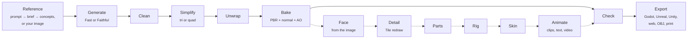
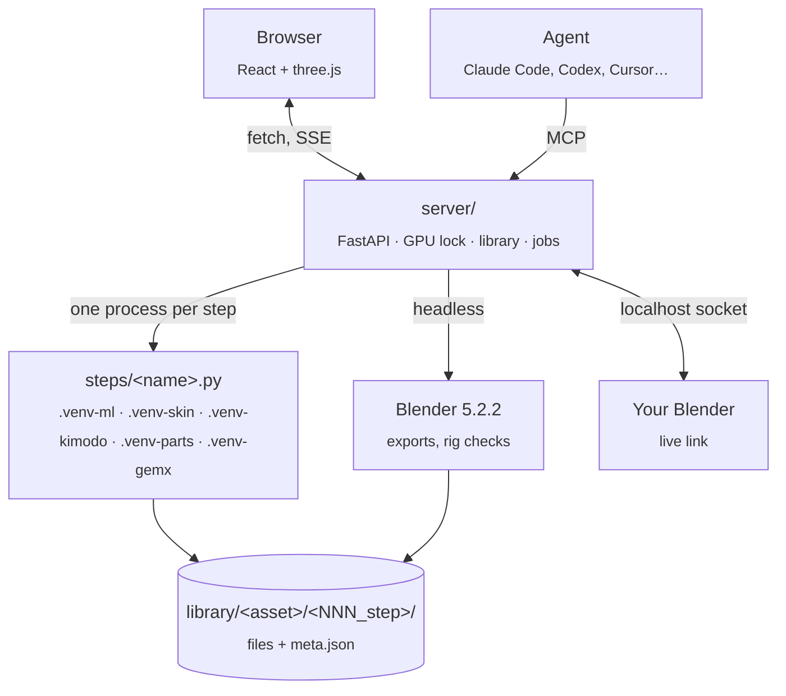

<p align="center">
  
</p>

<h1 align="center">Effigy</h1>

<p align="center">
  <b>Game-ready 3D assets and 2D sprites from a picture or a sentence, made on your own GPU.</b><br>
  Generate, clean, retopologize, texture, rig, animate and export, offline, on one 16 GB NVIDIA card.<br>
  New in 0.2.0: an AMD Radeon RX 9070 runs the <i>Fast</i> chain too.
</p>

<p align="center">
  
  
  
  
  
  
  
</p>

<p align="center">
  <a href="SETUP.md">Set it up</a> ·
  <a href="MANUAL.md">Manual</a> ·
  <a href="#capabilities">Capabilities</a> ·
  <a href="#how-it-works">How it works</a> ·
  <a href="docs/howto/">How-tos</a> ·
  <a href="#whats-under-the-hood">Under the hood</a> ·
  <a href="#let-an-agent-drive-it">Agents</a> ·
  <a href="#status">Status</a> ·
  <a href="#development">Development</a>
</p>

<p align="center">
  
</p>
<p align="center"><sub>Sixteen characters generated from concept images and put through the character chain. The blue dots are the
52 joints Effigy placed on its own; twelve of the sixteen needed no correction (<a href="docs/bench/m22.md">bench</a>).</sub></p>

<br>

<table>
  <tr>
    <td width="33%" valign="top">
      <h3>Local and offline</h3>
      Every model runs on your machine. After the install nothing leaves it: no accounts, no credits, no
      uploads of your art.
    </td>
    <td width="33%" valign="top">
      <h3>Commercial-clean</h3>
      One profile, no opt-in exceptions: every model, tool and clip pack allows commercial use of what it
      makes. Each export carries its <code>CREDITS.txt</code> and <code>LICENSES.json</code>.
    </td>
    <td width="33%" valign="top">
      <h3>Non-destructive and scriptable</h3>
      Every step writes a new version; nothing is overwritten and any step re-runs from any version.
      The same workflow is open to agents over MCP.
    </td>
  </tr>
</table>

## Capabilities

<table>
  <tr>
    <td width="50%" valign="top">
      <h4>Start from anything</h4>
      <ul>
        <li>A sentence becomes a brief and four concept images (Z-Image-Turbo)</li>
        <li>Or your own picture, or a four-view turnaround</li>
        <li>Background removed, camera fitted, characters re-posed to an A-pose</li>
      </ul>
    </td>
    <td width="50%" valign="top">
      <h4>Two 3D engines</h4>
      <ul>
        <li><b>Fast</b>: Microsoft TRELLIS.2</li>
        <li><b>Faithful</b>: Pixal3D, pixel-aligned to your image (the default after a blind A/B)</li>
        <li>The best setting your card runs is the default: 20 steps and 4K textures on 16 GB, 1536 on 24 GB and up</li>
        <li>Both keep the generated colour volume, so any later mesh can be re-baked from it</li>
      </ul>
    </td>
  </tr>
  <tr>
    <td valign="top">
      <h4>Game-ready geometry</h4>
      <ul>
        <li>Repair, then decimate to a triangle budget or to pure quads</li>
        <li>UV unwrap, then a full PBR re-bake: base colour, roughness, metallic, normal map, ambient occlusion, with supersampling and seam healing</li>
        <li>Retexture a mesh you edited in Blender from the same volume</li>
      </ul>
    </td>
    <td valign="top">
      <h4>Better textures</h4>
      <ul>
        <li>The face from your reference image projected onto the head</li>
        <li>An optional detail pass redraws close-up detail (buttons, stitching, wood grain) with Z-Image + ControlNet Tile and paints it back into the same UVs</li>
        <li>Baked shadows taken back out of the colour, so the engine's lighting doesn't double them</li>
      </ul>
    </td>
  </tr>
  <tr>
    <td valign="top">
      <h4>Rig and skin</h4>
      <ul>
        <li>A 52-joint humanoid skeleton fitted automatically</li>
        <li>Eight creature templates: fox, horse, bird, dragon, shark, kaiju, spider, snake</li>
        <li>Two skinning engines (SkinTokens, Blender bone heat) judged by a QA pass; a skeleton and marker editor for the rest</li>
      </ul>
    </td>
    <td valign="top">
      <h4>Animate</h4>
      <ul>
        <li>178 CC0 human clips and the creatures' own, retargeted onto your rig</li>
        <li>A new motion from a sentence (NVIDIA Kimodo) or from a video of a person (NVIDIA GEM-X)</li>
        <li>An editor with keys, foot locks, IK, trim, loop, speed, ground, in-place and duplicate clips</li>
        <li>The armature drawn the way Blender draws it, with IK targets and poles: a hand kept on a table, a foot on a step, the knee swung where you want it</li>
      </ul>
    </td>
  </tr>
  <tr>
    <td valign="top">
      <h4>Parts</h4>
      <ul>
        <li>Click a piece of the model to name it (GeoSAM2)</li>
        <li>Make it rigid on a bone: a helmet on the head, a sword in the hand</li>
        <li>Split a model into printable solids that fit together</li>
      </ul>
    </td>
    <td valign="top">
      <h4>Import and export</h4>
      <ul>
        <li>In: FBX, glTF/GLB, OBJ, USD, STL, PLY or a zip of them; a known skeleton and its clips are kept</li>
        <li>Bring your own model: clean it, bake its textures onto the simpler mesh, rig and animate it</li>
        <li>Animations made elsewhere (FBX, GLB, BVH on a Mixamo, Unreal or Kimodo skeleton) onto your characters</li>
        <li>Out: Godot, Unreal (LODs, UCX collision), Unity (LODs), web and AR (GLB + USDZ), OBJ, print (STL, 3MF); sprite sheets for Godot 2D and Unreal Paper2D</li>
        <li>Batch-export a whole selection into a folder</li>
      </ul>
    </td>
  </tr>
  <tr>
    <td valign="top">
      <h4>Blender, two ways</h4>
      <ul>
        <li>A pinned headless Blender 5.2.2 does the exports and rig checks</li>
        <li>A live link opens a version in <i>your</i> Blender and pulls the edited mesh back as a new version</li>
      </ul>
    </td>
    <td valign="top">
      <h4>A library that remembers</h4>
      <ul>
        <li>Versions per asset (<code>001_upload</code>, <code>002_clean</code>, …), never overwritten</li>
        <li>Thumbnails, turntables, compare two versions, tags, stars, licence badges</li>
        <li>Memory safeguards: a measured VRAM need per step, one GPU job at a time, refusals before an out-of-memory instead of a frozen machine</li>
      </ul>
    </td>
  </tr>
  <tr>
    <td valign="top">
      <h4>2D pictures and pixel art</h4>
      <ul>
        <li>Wallpapers, game backgrounds, portraits, icons and items from a sentence, any size up to 2048 px, optionally in a pixel-art, painting or children's-drawing style and cut out</li>
        <li>Upscale a picture 2× or 4×, or redraw it at any size, with an optional mask of what to keep</li>
        <li>Pixel art from any picture or sheet: the picture's own pixel grid found, one palette (or PICO-8) over every frame, ordered dither, a 1-pixel outline, palette swaps for variants</li>
        <li>A pixel editor for any sheet, or a blank one: pixel-perfect pencil, fills, shapes, selection, mirror, the palette's colours only; frames, timings, tags, onion skin and play</li>
      </ul>
    </td>
    <td valign="top">
      <h4>Sprites from your characters</h4>
      <ul>
        <li>Any animated character drawn from the side in whole pixels, every move in place, one scale per character</li>
        <li>Move sets for a side-scrolling fighter (Double Dragon, Golden Axe) and fighting moves from a sentence; attacks and hits play once</li>
        <li>Out: a Godot <code>SpriteFrames</code> + a ready <code>AnimatedSprite2D</code> scene, or a Paper2D sprite sheet (<a href="docs/howto/animate-a-pixel-art-character.md">how-to</a>)</li>
      </ul>
    </td>
  </tr>
</table>

<p align="center">
  
</p>
<p align="center"><sub>The Double Dragon move set on the bench viking, as 15-colour pixel art: 21 moves, 382 frames, from the 3D
character to a Godot sprite in under a minute (<a href="docs/howto/animate-a-pixel-art-character.md">how-to</a>,
<a href="docs/bench/m52.md">bench</a>).</sub></p>

<p align="center">
  
</p>
<p align="center"><sub>The optional detail pass: each pair is before | after; rows are front, three-quarter, back and a close-up
(<a href="docs/bench/m43b.md">bench</a>).</sub></p>

## How it works

The workflow is a line of stages. Solid ones run for every asset; dashed ones are optional and mostly for
characters.



Each stage is a Python module in `steps/` that runs as its own process in the environment its model needs,
reads one version folder and writes the next. The backend never imports torch: it owns the library, the job
queue, the GPU lock and the Blender link, and streams progress to the browser.



### Timings

Measured on the reference machine (RTX 5080 Laptop, 16 GB VRAM, 32 GB RAM); every number comes from a bench
document under [`docs/bench/`](docs/bench/).

| What | Time |
|---|---|
| Four concept images from a prompt | ~70 s |
| Image → 3D model (Faithful, median) | ~2 min |
| A prop through the whole chain to export (median) | ~3 min |
| Skeleton fit | 9 s |
| Face projection | 6–8 s |
| Texture detail pass | 2.5–4.5 min |
| Motion from a sentence | 30 s cold, ~4 s warm |
| Motion from a video | ~2 min |
| A 1920 × 1088 picture (warm) | ~29 s |
| Sprites of a 21-move set (382 frames) | 7 s |
| Pixel art of that sheet | ~21 s |

## What's under the hood

Every model, tool and dataset is listed in [`licenses.yaml`](licenses.yaml) and shown on the app's Licences
page. All of them allow commercial use of what they produce; three carry an attribution (DINOv3, Llama 3, and a courtesy credit for the CC0 Mesh2Motion clips) that the export writes into
`CREDITS.txt`. You choose what to download: props only, characters, characters with motion, or everything
(60 to 141 GB).

| Stage | Model or tool | Licence |
|---|---|---|
| Concept images | Z-Image-Turbo | Apache-2.0 |
| Background, camera | BiRefNet; MoGe-2 | MIT; MIT |
| A-pose | FLUX.2-klein-4B; DWPose | Apache-2.0; Apache-2.0 |
| 3D, *Fast* | TRELLIS.2-4B, TRELLIS-image-large | MIT |
| 3D, *Faithful* | Pixal3D (+ NAF); DINOv3 | MIT (Apache-2.0); DINOv3 licence, "Built with DINOv3" |
| Mesh kernels | TRELLIS.2's CuMesh, flex_gemm, o_voxel, built for sm_89 and sm_120 (`wheels/`), and with HIP for AMD gfx1201 (`wheels/rocm/`) | MIT |
| Face from the image | Real-ESRGAN (4× upscale; also picture upscale) + our projection | BSD-3-Clause |
| Texture detail | Z-Image-Turbo + Fun-ControlNet-Union 2.1 (Tile; also picture redraw) | Apache-2.0 |
| Parts | GeoSAM2 | Apache-2.0 |
| Skinning | SkinTokens; or Blender's bone heat | MIT; GPL (separate process) |
| Animation clips | Mesh2Motion packs | CC0 |
| Motion from text | Kimodo (SOMA skeleton); Llama 3 8B Instruct + LLM2Vec as its text encoder | NVIDIA Open Model Licence; Llama 3 Community Licence (gated, "Built with Meta Llama 3"); MIT |
| Motion from video | GEM-X; SAM 3D Body; MHR | NVIDIA Open Model Licence; SAM licence; Apache-2.0 |
| Blender ops, exports | Blender 5.2.2 LTS (pinned, SHA-256 checked); gltfpack | GPL-3.0-or-later (its own process); MIT |
| 2D pictures, styles | Z-Image-Turbo + three style LoRAs (pixel art, classic painting, children's drawings) through peft | Apache-2.0 |
| Pixel art, sprite sheets | our own (numpy, Pillow); sprites drawn by Blender's Workbench; the PICO-8 palette | MIT; GPL (its own process); CC0 |

What the policy rules out and why (non-commercial weights, region-restricted licences, models trained on data
you can't ship) is in [docs/PLAN.md §6](docs/PLAN.md#6-licence-policy).

## Hardware and install

| | |
|---|---|
| **GPU** | An NVIDIA card with 16 GB (the reference is an RTX 5080 Laptop; 12 GB works for the *Fast* engine, best effort). The bundled CUDA kernels are built for the RTX 40 and 50 series; older cards need a rebuild (`.github/workflows/wheels.yml`). |
| **AMD GPU** | An AMD Radeon RX 9070 or 9070 XT runs the *Fast* chain end to end, about as fast as the reference laptop ([bench](docs/bench/amd-rocm.md)). `run.bat` sees the card and installs the AMD (ROCm) environment by itself ([how-to](docs/howto/amd-rocm-windows.md)). Not on AMD yet: *Faithful*, the character chain, motion from text or video, and other AMD cards. |
| **OS** | Windows 11, driver 575 or newer. Linux runs from source with the same `uv sync`, but the three kernel wheels are Windows builds: bring your own. |
| **Disk** | 70–160 GB, mostly models; they can live on another drive. |
| **RAM** | 32 GB recommended: the 3D engines peak at ~20 GB of host memory. |

Install = download the zip from [Releases](https://github.com/SifuInTheShell/Effigy/releases/latest), unzip and
double-click `run.bat`. It downloads Python, PyTorch, Blender and the models you pick into
its own folder; nothing is installed system-wide, and uninstalling is deleting the folder. It writes
`run.log` next to itself (which GPU it found, and on AMD the install's output). To update, unpack the newest
zip into the same folder: your library, models, Python and Blender stay. The step-by-step
guide, including the Hugging Face login for the gated models, is **[SETUP.md](SETUP.md)**. From a git
checkout, `run.bat` (or `run.sh`) does the same.

## Let an agent drive it

The `effigy` MCP server (`mcp/effigy_server.py`) gives any MCP client the whole workflow as tools:

| Browse | Make | Finish | Blender |
|---|---|---|---|
| `list_assets`, `get_asset`, `get_version`, `describe_steps`, `look` (rendered previews the agent can see), `read_file`, `fit_check` | `create_asset`, `import_file`, `run_step`, `job_status`, `cancel_job` | `validate`, `export` | `open_in_blender`, `pull_from_blender`, `close_in_blender` |

Setup → **Connect an agent** prints the configuration for Claude Code, Claude Desktop, Codex, Cursor and
Gemini CLI, with absolute paths: use that, not the repo's `.mcp.json`, which is relative and serves only a
Claude Code session started inside the checkout. The API answers only local requests, so the agent runs on
the machine the app runs on. A typical session: import a zip,
`look` at it, clean and simplify it, validate, export into a folder for Godot; jobs are bounded and the agent
polls `job_status` like the UI does.

**Batch from the command line**: with the app running, `uv run python -m tools.bench --preset game-prop --set
<folder of images> --export godot --to <folder> --out <file>.csv` runs the preset over every image, exports each
result and copies it into `<folder>/<asset>_godot/`, one CSV row per image (seconds and VRAM per step, the checks,
the export folder). A run that stops midway is not resumed: run it again on the images that are left (every image
becomes a new asset, nothing is overwritten).

## Status

Effigy is young (started October 2026) and has been exercised on **one machine**, plus a contributor's AMD
card for the *Fast* chain. What's in the benches under [`docs/bench/`](docs/bench/) is real and measured; what
isn't there hasn't been run. Known limits:

- Windows first; Linux from source only. No macOS (no CUDA).
- AMD: the RX 9070 / 9070 XT only (its kernel wheels are built for gfx1201) and the *Fast* chain only; the
  rest of the app still needs an NVIDIA card.
- Engine imports were checked headless for Godot 4.7 and Unreal 5.8; the Unity export is written to Unity's
  conventions but has not been import-checked yet. The 2D sprites were checked in Godot 4.7; Unreal's Paper2D
  import needs the editor and is not checked yet.
- The automatic skeleton fit is right on about three of four characters; the editor covers the rest. Creature
  fits depend on a clean mesh (touching legs or a fused snout fail a skin check).
- The brief step is template-based, no LLM in the loop. The detail pass can invent detail (a per-view keep/drop
  is open).
- An experimental Hunyuan3D engine is designed but not built; if it ever is, its outputs are fenced as
  *restricted* (its licence excludes the EU, UK and South Korea) and never reach a preset.

## Development

Needs [uv](https://docs.astral.sh/uv/) and Node 22. `run.bat` / `run.sh` syncs the Python environments,
downloads the pinned Blender and gltfpack on first run, builds the UI once and serves it on
http://127.0.0.1:8000 (another port: Setup, App address, or `EFFIGY_PORT`).

```sh
uv sync --frozen                                   # .venv: backend, tests, lint (Python 3.12)
uv run pytest -q && uv run ruff check . && uv run ruff format --check .
UV_PROJECT_ENVIRONMENT=.venv-ml uv sync --frozen --group ml       # the ML steps (torch 2.8 cu128)
UV_PROJECT_ENVIRONMENT=.venv-ml uv run --frozen --group ml pytest -q   # the ML suite (CPU; GPU tests need EFFIGY_GPU_TESTS=1)
cd ui && npm ci && npm run build && npx playwright test            # the UI and its browser tests
uv run python -m server.blender_install            # pinned Blender into blender/
python tools/package.py                            # the Windows portable zip into dist/
```

| Folder | What |
|---|---|
| `server/` | FastAPI backend: library, jobs, the GPU and RAM safeguards, installs, the Blender link, exports |
| `steps/` | one module per pipeline step, run as a subprocess; `_*.py` are shared helpers (mesh, bake, views, animation maths) |
| `engine/` | vendored engines (TRELLIS.2 patches, Pixal3D, GeoSAM2, GEM-X) with their licences and `PATCHES.md` |
| `blender_ops/` | headless Blender scripts (GPL-3.0-or-later, the only non-MIT code here) |
| `mcp/` | the MCP server for agents |
| `ui/` | Vite + React + TypeScript + three.js; `ui/tests/` are the Playwright specs |
| `tools/` | model downloads and the manifest, the benches, packaging |
| `docs/` | plan, architecture, the user journey, setup, the implementation notes, research, benches |
| `tests/` | pytest suites (backend, steps, Blender ops, exports) |
| `wheels/` | the CUDA kernel wheels for Windows; `wheels/rocm/` the AMD (HIP) ones |

Environment variables (never committed): `EFFIGY_MODELS` and `EFFIGY_LIBRARY` move the two big folders;
`EFFIGY_BLENDER` and `EFFIGY_GLTFPACK` point at existing installs; `EFFIGY_BLENDER_MCP_PRO_DIR` and
`BLENDER_MCP_PRO_LICENSE` are for the live link through Blender MCP Pro (the free `blender-mcp` add-on works
too).

How the project is run: one milestone per branch and PR (the list is in `docs/IMPLEMENTATION.md` §4), acceptance checks in the PR, the numbers recorded in
`docs/bench/`; contributors start at [CONTRIBUTING.md](CONTRIBUTING.md). Contracts between steps (file names, frames, units, `meta.json`) are frozen in
[docs/IMPLEMENTATION.md §3](docs/IMPLEMENTATION.md); coding agents start there. CI workflows run on request
only.

## Documents

| | |
|---|---|
| [SETUP.md](SETUP.md) | from a fresh Windows machine to the first asset |
| [MANUAL.md](MANUAL.md) | the user manual: every page, panel and tool of the app |
| [CONTRIBUTING.md](CONTRIBUTING.md) | how the project is run and how to send a change |
| [docs/WORKFLOW.md](docs/WORKFLOW.md) | the user journey, prompt to export |
| [docs/howto/](docs/howto/) | step-by-step guides, such as animating a pixel-art character for a 2D game |
| [docs/PLAN.md](docs/PLAN.md) | why it exists, the decisions, the licence policy, the roadmap |
| [docs/ARCHITECTURE.md](docs/ARCHITECTURE.md) | processes, the GPU scheduler, the asset store, packaging |
| [docs/IMPLEMENTATION.md](docs/IMPLEMENTATION.md) | milestones, frozen contracts, what was built and measured |
| [docs/research/](docs/research/) | the surveys behind each choice: generators, texturing, rigging, motion, Blender, agents |
| [docs/bench/](docs/bench/) | every measured number and sheet |

## Licence

MIT (see [LICENSE](LICENSE)), except `blender_ops/`, which is GPL-3.0-or-later because it runs inside Blender.
Models, tools and datasets keep their own licences, listed in [`licenses.yaml`](licenses.yaml); Effigy's own
code and the assets you make with it are yours.
