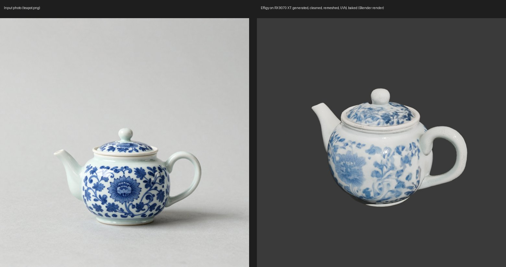
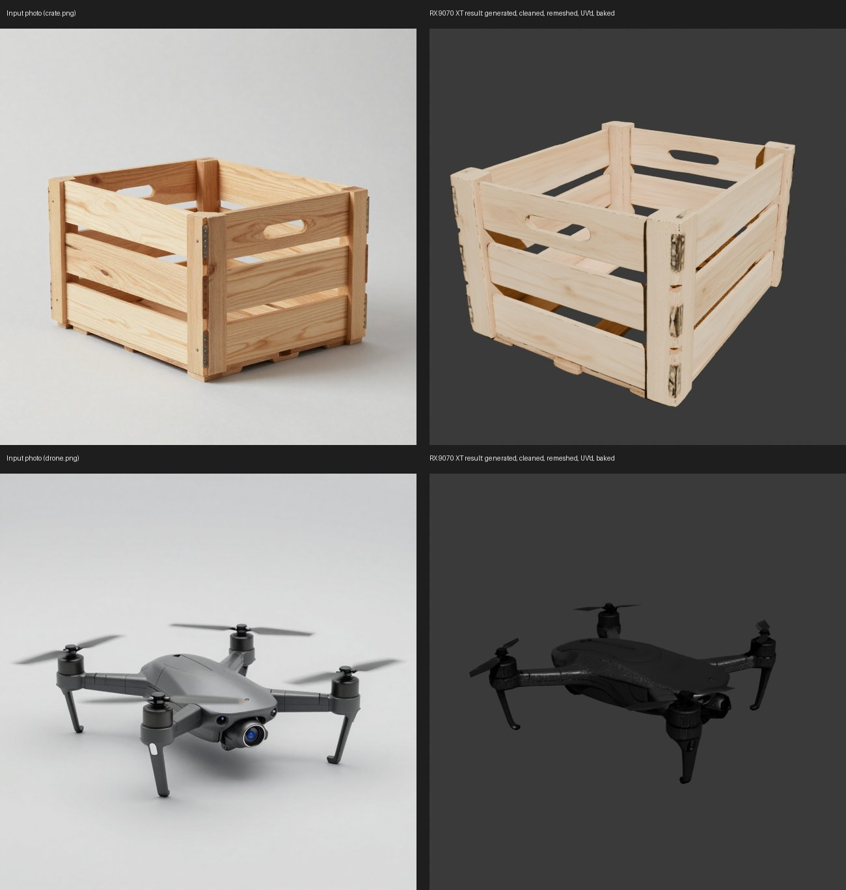

# Effigy end to end on an AMD RX 9070 XT (native Windows, ROCm)

2026-10-15. **Result: one image → game-ready, baked, exported 3D asset, entirely on the 9070 XT.** Effigy's
own bench, chain `game-prop` with the Fast engine (TRELLIS.2-4B), on `tests/fixtures/golden/anvil.png`:
**1/1 succeeded, every step, 0 NaN vertices, 0 non-manifold edges, 0 checklist fails.** Setup:
[docs/howto/amd-rocm-windows.md](../howto/amd-rocm-windows.md).

| | |
|---|---|
| GPU | AMD Radeon RX 9070 XT (gfx1201, 16 GB), driver 32.0.22042.14002, Windows 11 Pro 26200, 64 GB RAM |
| Stack | torch 2.9.1+rocm7.2.1 (AMD's Windows wheels), Python 3.12, Blender 5.2.2 LTS |
| Effigy | `main` @ `ab536d1` + this branch's changes (the CSVs' `commit:` lines are the pre-rebase local commits) |
| Kernels | `wheels/rocm/` (CuMesh, FlexGEMM, o_voxel built with HIP for gfx1201) |
| Raw data | `amd_rocm_anvil.csv`, `amd_rocm_teapot.csv`, `amd_rocm_crate_drone.csv`; reference: `phase0_fast.csv` |

## Timings and VRAM per step vs the NVIDIA reference

NVIDIA = the reference laptop (RTX 5080 Laptop, 16 GB, torch 2.8.0+cu128, `phase0_fast.csv`, 2026-10-04),
same image, same chain, same weights (different random seed).

| Step | 9070 XT s | NVIDIA s | 9070 XT whole-GPU peak | NVIDIA whole-GPU peak | Step's own torch peak (9070 XT / NVIDIA) |
|---|---:|---:|---:|---:|---|
| prep (BiRefNet cut-out) | 16.3 | 21.1 | 8.28 GB | 3.44 GB | – |
| **trellis2** (Fast, 1024 cascade, 12 steps) | **146.4** | **169.9** | 14.95 GB | 10.17 GB | **4.28 / 4.42 GB** |
| clean | 22.0 | 13.0 | 6.68 GB | 9.18 GB | – |
| remesh (10k tris) | 8.1 | 4.6 | 6.65 GB | 9.14 GB | – |
| uv | 8.2 | 3.4 | 6.42 GB | 9.12 GB | – |
| bake (2K) | 26.1 | 18.8 | 9.90 GB | 2.95 GB | 3.16 GB (bake's own) / – |
| validate | 3.1 | 1.1 | 3.82 GB | 0.73 GB | – |
| export (Godot) | 3.6 | 2.3 | 3.82 GB | 0.73 GB | – |
| **chain total** | **233.8** | **234.2** | | | |

TRELLIS.2 inside its 146 s (step metrics): 16.7 s model load, 104.7 s sampling (sparse structure ~6 s,
shape ~33 s, texture ~16 s at 1024), the rest decode, simplify, unwrap and the volume bake; 3.46M voxels,
7.0M hi-res faces simplified to 197k.

Reading the VRAM columns:
- **Whole-GPU** is the card's total use, sampled every 0.5 s (here from the Windows "GPU Adapter Memory"
  counter, `server/gpu_amd.py`; NVIDIA from nvidia-smi). **The test desktop holds 3.69 GB with Effigy idle**
  (several monitors and other apps open) against ~0.73 GB on the laptop, and the resident TRELLIS.2 worker
  keeps its models on the card during the light steps, so these columns are not like for like.
- **The fair comparison is the step's own torch peak: TRELLIS.2 4.28 GB on the 9070 XT vs 4.42 GB on NVIDIA.**
  The row-blocked explicit GEMM costs no more memory than Triton's implicit GEMM.
- Every step stayed inside the 16 GB card (worst: trellis2 at 14.95 GB whole-GPU, of which ~3.7 GB is the
  desktop); the pre-flight gave TRELLIS.2 a 10.9 GB budget from what was free.

Speed: the GPU-heavy generation is ~14 % faster than the RTX 5080 Laptop, the whole chain the same. The
CuMesh-heavy steps (clean, remesh, uv) and bake are ~1.5–2.4× slower; one run each, not profiled further.

Mesh quality vs NVIDIA anvil: 9,358 vs 9,581 faces (budget 10k), 0 vs 3 non-manifold edges, 1 vs 1
component, texel density p10/p90 0.936/1.052 vs 0.882/1.068, 0 vs 0 checklist fails.

## More images (same code, same day)

| Image | Result | trellis2 s (9070 XT / NVIDIA) | torch peak GB | chain s (9070 XT / NVIDIA) | faces | non-manifold (9070 XT / NVIDIA) | checklist fails |
|---|---|---:|---:|---:|---:|---:|---:|
| anvil | ok | 146.4 / 169.9 | 4.28 / 4.42 | 233.8 / 234.2 | 9,358 | 0 / 3 | 0 |
| teapot | ok | 129.1 / 157.8 | 4.83 / 5.06 | 230.3 / 221.3 | 9,412 | 0 / 2 | 0 |
| crate | ok | **225.5 / 704.6** | 6.42 / 7.47 | **317.1 / 763.3** | 9,782 | 0 / 13 | 0 |
| drone | ok | 60.6 / 100.2 | 2.83 / 3.04 | 139.7 / 173.6 | 9,742 | 0 / 16 | 0 |

4/4 images through every step, 0 NaN vertices in any export. The crate was the NVIDIA laptop's worst case
(it spilled into shared memory at 15.5 GB); here it fits. The drone bakes darker than its photo, as
`phase0.md` notes for Fast on NVIDIA.

## What it took

Five ROCm-on-Windows problems, each found on this run, each fixed and checked against a reference:

1. **GEMMs are wrong above 2^19 rows.** On torch 2.9.1+rocm7.2.1 (hipBLASLt and rocBLAS alike) an
   `[M, K] @ [K, N]` returns wrong numbers once M > 524,288 in fp32 (> 2^20–2^22 in fp16/bf16, depending
   on shape); at 3.6M rows fp16 gives Inf/NaN. TRELLIS's decoders run per-voxel layers over 3–4M voxels, so
   they returned garbage: 9.5 % NaN mesh vertices, NaN texture voxels. **Fix:** `steps/_rocm.py` computes
   `F.linear`, `matmul`, `mm`, `addmm` 2^18 rows at a time on ROCm (installed lazily when a step imports
   torch; no-op on CUDA/CPU). Checked against the CPU at 3.64M rows on every patched entry point, and
   2^18-row blocks across K up to 1,728 and N up to 1,024 in fp32/fp16/bf16.
2. **`hipMemcpy2D` copies only ~2^20 rows.** CuMesh's `init` used `cudaMemcpy2D`; on Windows HIP it left
   every vertex/face past ~1M zero. **Fix:** packed rows as one linear copy, others in 65,536-row chunks
   (`engine/trellis2/cumesh-rocm-windows.patch`, `src/io.cu`). 5.24M → 561k-face simplify now 0.45 s.
3. **`cudaMallocAsync` hangs HIP's first allocation** and `expandable_segments` isn't supported on Windows;
   with the native allocator the mesh decoder fragmented. **Fix:**
   `backend:native,max_split_size_mb:256,garbage_collection_threshold:0.6` on AMD (`server/jobs.py`).
4. **FlexGEMM's explicit GEMM gathers all 27 neighbours first** (2.9 GB im2col at decoder resolution).
   **Fix:** the same product a block of rows at a time (`engine/trellis2/patches.py`), identical results
   (fp32 exact, fp16 within one rounding step).
5. **BiRefNet in fp16 returns an all-zero matte** on ROCm. **Fix:** fp32 on ROCm (`steps/_birefnet.py`),
   0.8 s per image once MIOpen has compiled its kernels (~20 s on first use, cached after).

Plus the app-level NVIDIA assumptions: `server/gpu_amd.py` answers what nvidia-smi did (name, VRAM, driver
from DXGI; device-wide VRAM in use from the PDH counter, because HIP's `mem_get_info` ignores other
processes and `amd-smi.exe` failed with `Error LoadLibraryA` on the test machine); machine check, GPU
pinning, VRAM pre-flight, `gpu_load` and the bench sampler fall back to it; FlexGEMM is forced to
`explicit_gemm` (no Triton on Windows + AMD).

Kernel smoke test (`tools/smoke_amd.py`): 9/9 checks pass against independent references (CuMesh
simplify / duplicate faces / connected components, cuBVH distance and ray depths max err 2.4e-7, o_voxel
z-order and Hilbert round trips, FlexGEMM sparse conv vs dense `conv3d` max err 2e-6).

## Not done / caveats

- One run per image; Faithful (Pixal3D), the character chain, GEM-X, Kimodo, MoGe and the other venvs
  were not tried on ROCm.
- The GEMM row limit is worked around in Effigy's step processes only.
- The CuMesh-heavy steps are slower than on NVIDIA; not profiled.
- gfx1201 (RX 9070 / 9070 XT) only: the HIP wheels are built for that one architecture.
